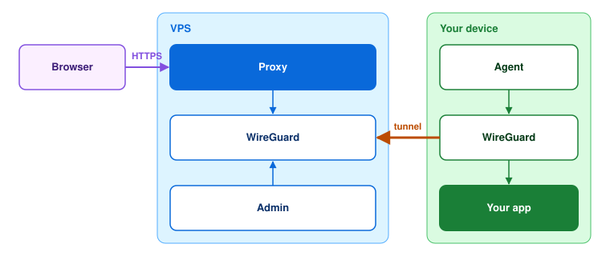

# Warren

Warren puts the web apps on your router, NAS or home server on the internet
at an HTTPS address. You do not open any ports at home.

It is like Tailscale plus Cloudflare Tunnel, but you host it on one cheap VPS.

<picture>
  <source media="(prefers-color-scheme: dark)" srcset="docs/architecture-dark.svg">
  
</picture>

- Your device connects out to the VPS, so Warren works behind NAT and CGNAT.
  Nothing listens on the device.
- The server is one binary of about 9 MB. It has the WireGuard hub, the
  reverse proxy, Let's Encrypt certificates, the web admin, an API and SQLite.
- The agent for OpenWrt routers and Linux boxes is about 470 KB. It also
  runs on macOS.
- You publish a service with one form, then open
  `https://app.warren.example.com`.
- Each service is public, or it asks for a Warren login, Basic auth or a PIN.
- Phones and laptops connect with the usual WireGuard app and a QR code.

## Get started

You need:

- a Linux VPS with 512 MB of RAM or more;
- a domain, with `warren.example.com` and `*.warren.example.com` pointed at
  the VPS;
- ports 80/tcp, 443/tcp and 51820/udp open on the VPS.

1. Install the server on the VPS:
   ```sh
   curl -fsSL https://github.com/slopworks-org/warren/releases/latest/download/install.sh \
     | sudo sh -s -- server --domain warren.example.com --email you@example.com
   ```
   It installs `warren-server`, writes `/etc/warren/server.toml`, creates
   the `admin` account and starts the systemd service. All other options are
   in [`dist/server.toml`](dist/server.toml). Run the same command without
   `--domain` and `--email` to upgrade.
2. Sign in at `https://warren.example.com` as `admin` with the password that
   the installer prints, and change the password. If you installed the server
   another way, run `sudo warren-server create-admin admin`; it prints a
   password.
3. Add a device. In the admin, go to Devices → Add device → With the agent →
   Create token. Install the agent on the device with that token:
   ```sh
   curl -fsSL https://github.com/slopworks-org/warren/releases/latest/download/install.sh \
     | sudo sh -s -- agent --server https://warren.example.com --token wrt_…
   ```
   On OpenWrt there is no curl or sudo; run this as root instead:
   ```sh
   wget -qO- https://github.com/slopworks-org/warren/releases/latest/download/install.sh \
     | sh -s -- agent --server https://warren.example.com --token wrt_…
   ```
   On macOS, install wireguard-go first: `brew install wireguard-go`.
   The script installs `kmod-wireguard` on OpenWrt (opkg or apk), registers
   the device and starts the agent service (systemd, OpenWrt init or
   launchd). Check it with `warren status`.
4. Publish a service. Go to Resources → Publish service. Set the address, the
   device and the port.

The script checks every download against the release's `SHA256SUMS`.
`--version v0.1.0` installs a given release. You can also download the
binaries, the OpenWrt `.ipk` and the service files from the
[releases page](https://github.com/slopworks-org/warren/releases) and
install them by hand.

<details>
<summary><b>Build from source</b></summary>

You need [just](https://github.com/casey/just) and Rust 1.92 or later, and
Docker for the server build. The files go to `dist/out/`.

```sh
just server amd64      # or arm64
just agent aarch64     # or armv7, x86_64; macos-aarch64, macos-x86_64 on a Mac
just ipk               # OpenWrt package
```
</details>

## Updates

The server checks GitHub for a new release once a day. When one is out,
administrators see a notice in the admin. Click **Update now** to install it:
the server downloads the release, checks it against `SHA256SUMS` and
restarts. To install new releases without the button, set `auto = true` in
the `[update]` section of `server.toml`.

Agents update from the server, inside the tunnel. When an agent runs an
older version than the server, Devices shows **Update agents**. Each agent
then downloads its build from the server, checks that the new binary runs,
replaces itself and restarts. With `auto = true`, agents follow the server
version without the button.

Servers and agents installed before this feature need one upgrade with
`install.sh`. On the server, it also installs the new systemd unit. The
container image does not update itself; pull a new image instead.

## Devices on one LAN

Two agents on the same LAN send traffic to each other directly, not
through the VPS. The server pairs two agents when it sees them behind the
same public address and they have addresses in one subnet. The two devices
must be allowed to exchange all traffic. By default, this applies to the
devices of one user. Port rules apply only on the server, so pairs that
have only port rules always go through the VPS.

Blocking a user or disabling a device revokes access through the server.
An established direct LAN connection can remain active if the agents can
no longer reach the server to receive updated configuration. This is
intentional: Warren does not isolate devices on their local network.
The direct tunnel grants no additional access through the server or to
other Warren peers.

Each agent checks the direct path. If no packets come from the other agent
for 25 seconds, the agent sends the traffic through the VPS again.
`warren status` shows the path to each LAN peer. If a host firewall blocks
the agent's WireGuard port, the two agents stay on the VPS path. Phones and
laptops with the WireGuard app always use the VPS. To turn this feature
off, set `lan_peers = false` in the `[wireguard]` section of `server.toml`.

## Also included

Users and roles, two-factor login (TOTP), device ACLs, an audit log, and an
HTTP API for all admin actions.

## Limits

- No DNS-01, so no automatic wildcard certificates. To use your own
  certificate, set `mode = "files"` in the `[tls]` section.
- Only IPv4 inside the tunnel.
- The agent needs kernel WireGuard on Linux and wireguard-go on macOS.
- No direct paths between devices on different networks, no OIDC, no raw
  TCP/UDP forwarding, no multiple servers.

## Change the code

To learn how Warren works inside, ask your coding agent.
[CLAUDE.md](CLAUDE.md) gives it the map. Run `just check` before you
send a change.

## License

AGPL-3.0-or-later. See [LICENSE](LICENSE).
