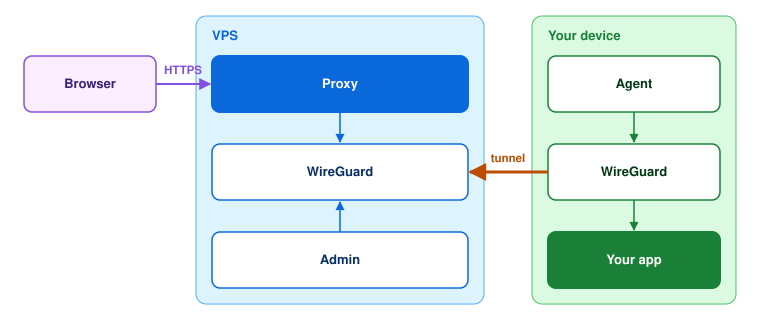

# Warren

Warren puts the web apps on your router, NAS or home server on the internet
at an HTTPS address. You do not open any ports at home.

It is like Tailscale plus Cloudflare Tunnel, but you host it on one cheap VPS.

<picture>
  <source media="(prefers-color-scheme: dark)" srcset="docs/architecture-dark.svg">
  
</picture>

- Your device connects out to the VPS, so Warren works behind NAT and CGNAT.
  Nothing listens on the device.
- The server is one binary of about 9 MB. It has the WireGuard hub, the
  reverse proxy, Let's Encrypt certificates, the web admin, an API and SQLite.
- The agent for OpenWrt routers and Linux boxes is about 470 KB. It also
  runs on macOS.
- You expose a service on the device, publish its name in the dashboard, then open
  `https://app.warren.example.com`.
- Each service is public, or it asks for a Warren login, Basic auth or a PIN.
- Phones and laptops connect with the usual WireGuard app and a QR code.

## Get started

You need:

- a Linux VPS with 512 MB of RAM or more;
- a domain, with `warren.example.com` and `*.warren.example.com` pointed at
  the VPS;
- ports 80/tcp, 443/tcp and 51820/udp open on the VPS.

1. Install the server on the VPS:
   ```sh
   curl -fsSL https://github.com/slopworks-org/warren/releases/latest/download/install.sh \
     | sudo sh -s -- server --domain warren.example.com --email you@example.com
   ```
   It installs `warren-server`, writes `/etc/warren/server.toml`, creates
   the `admin` account and starts the systemd service. All other options are
   in [`dist/server.toml`](dist/server.toml). Run the same command without
   `--domain` and `--email` to upgrade.
2. Sign in at `https://warren.example.com` as `admin` with the password that
   the installer prints, and change the password. If you installed the server
   another way, run `sudo warren-server create-admin admin`; it prints a
   password.
3. Add a device. In the admin, go to Devices → Add device → With the agent →
   Create token. Install the agent on the device with that token:
   ```sh
   curl -fsSL https://github.com/slopworks-org/warren/releases/latest/download/install.sh \
     | sudo sh -s -- agent --server https://warren.example.com --token wrt_…
   ```
   On OpenWrt there is no curl or sudo; run this as root instead:
   ```sh
   wget -qO- https://github.com/slopworks-org/warren/releases/latest/download/install.sh \
     | sh -s -- agent --server https://warren.example.com --token wrt_…
   ```
   On Linux, install nftables. On macOS, install wireguard-go and configure
   the [packet filter](#agent-ingress-policy) before starting the agent.
   The script installs WireGuard and nftables on OpenWrt (opkg or apk), registers
   the device and starts the agent service (systemd, OpenWrt init or
   launchd). Check it with `warren status`.
   Agent commands automatically request administrator privileges through `sudo`
   when needed. On systems without `sudo`, run the agent as root.

   For the native Warren Android app, choose **Devices → Add device → Warren
   Android app** and scan the one-time enrollment QR in the app. **WireGuard
   config** still creates a configuration for the standard WireGuard app.
4. On the device, allow a local service:
   ```sh
   warren expose grafana 3000
   ```
   This forwards to `127.0.0.1:3000`. Use a hostname or IP with a port for another
   address, or `warren expose console https://127.0.0.1:8443` for HTTPS.
5. In **Resources → Publish service**, choose the device and exposed service.
   Set the hostname, access policy and enabled state. Run `warren expose --list`
   or `warren status` on the device to see local targets and published URLs.
   `warren unexpose grafana` withdraws the grant and closes active streams.
   Changes take effect while the daemon runs. Grant files persist under
   `services/` in the agent configuration directory.

### Agent ingress policy

The agent opens each service stream outward over its WireGuard control channel.
Only the service name and protocol leave the device. The agent looks up the
target locally for every new connection. Incoming connections to application
ports on both Warren interfaces are blocked, including traffic forwarded by
the hub and connections from other devices. Outbound traffic, its replies,
and IPv4 echo requests remain available.

Linux requires the `nft` command and kernel connection tracking. On macOS,
place `anchor "warren/*" quick` as the first filter rule in your PF
configuration, after translation rules. Load that configuration and enable
PF before starting Warren. Each utun gets its own anchor. Warren refuses
to configure peers if it cannot install the ingress policy.

Upgrade the agents to enforce the local policy. Upgrading the server disables
existing port-based publications and preserves their hostnames and access
settings. Edit each route to select a client-exposed service and enable it.
Manual WireGuard and Android profiles can use the tunnel but cannot advertise
services through this protocol.

The script checks every download against the release's `SHA256SUMS`.
`--version v0.1.0` installs a given release. You can also download the
binaries, the OpenWrt `.ipk` and the service files from the
[releases page](https://github.com/slopworks-org/warren/releases) and
install them by hand.

See [Android enrollment](docs/android-enrollment.md) for the client protocol
and isolated lab setup.

<details>
<summary><b>Build from source</b></summary>

You need [just](https://github.com/casey/just) and Rust 1.92 or later, and
Docker for the server build. The files go to `dist/out/`.

```sh
just server amd64      # or arm64
just agent aarch64     # or armv7, x86_64; macos-aarch64, macos-x86_64 on a Mac
just ipk               # OpenWrt package
```
</details>

## Updates

The default `release` channel follows stable tagged releases. The `main`
channel follows successful builds of commits to the main branch. A version
such as `0.4.0-main.65.g0012345` identifies the base version, first-parent
commit count, and abbreviated commit hash. Each build has its own prerelease
tag and checksums. The rolling `channel-main` prerelease points to the
current build. The five most recent main builds are retained.

### Devices

Updates are managed on the device by default. On Linux, OpenWrt and macOS:

```sh
warren status                    # Show the installed version and any available release
warren update --check            # Check the configured channel without installing
warren update --check --channel main  # Check main once, keeping the current setting
warren update --channel main     # Follow main builds
warren update --channel release  # Return to stable releases
warren update                    # Verify and stage the available update
warren update --remote on        # Allow automatic and dashboard-requested updates
warren update --remote off       # Return to local updates only
```

To install a device directly from main, use the rolling installer:

```sh
curl -fsSL https://github.com/slopworks-org/warren/releases/download/channel-main/install.sh \
  | sudo sh -s -- agent --channel main
```

Selecting a channel persists the choice. Run `warren update` to install
an available build. Switching channels can install the same base version.
An installed higher base version is kept until the chosen channel catches up.

The agent downloads builds and SHA256SUMS from the official GitHub release
over HTTPS. In-place updates require system `curl` and trusted CA
certificates. The installation and configuration paths must be root-owned
and writable only by root. Use separate executable paths for registrations
that run concurrently. The service starts the candidate from its staged path
and replaces the installed binary only after the candidate's supervisor
confirms that its worker has configured the local tunnel. If the service is
stopped, `warren update` reports the release as staged and the trial runs on
the next service start. A failed or interrupted trial leaves the previous
binary installed.

On OpenWrt, the IPK installs `curl` and `ca-bundle`. The shell installer
installs them when called with `agent --remote on`. For manual updates on
an existing shell installation, install those packages with `opkg` or `apk`.
Enabling remote updates checks that the agent can reach the official release
over certificate-validated HTTPS. Devices running an older agent can rerun
the installer to get the update commands.

The Devices page shows the installed and available versions. For an opted-in
device, **Update** requests a check. Agents wait at least an hour between
checks prompted by the dashboard, and offline devices check after reconnecting.
Opted-in agents also check daily on release or hourly on main. Android app updates
are installed on the phone.

### Server

The server checks GitHub for release metadata independently of its own
version. Upgrade it by rerunning the server installer or pulling a new
container image. Operators using the packaged systemd unit can also set
`[update]` → `auto = true` in `server.toml` for unattended server updates.
Set `channel = "main"` in the same section to follow commit builds, or
`channel = "release"` for stable releases. These settings apply to the server.
For a fresh server on main, use the rolling installer:

```sh
curl -fsSL https://github.com/slopworks-org/warren/releases/download/channel-main/install.sh \
  | sudo sh -s -- server --channel main --domain warren.example.com --email you@example.com
```

Rerunning the installer preserves an existing server configuration.

## Devices on one LAN

Two agents on the same LAN send traffic to each other directly, not
through the VPS. The server pairs two agents when it sees them behind the
same public address and they have addresses in one subnet. The two devices
must be allowed to exchange all traffic. By default, this applies to the
devices of one user. Port rules apply only on the server, so pairs that
have only port rules always go through the VPS.

Blocking a user or disabling a device revokes access through the server.
An established direct LAN connection can remain active if the agents can
no longer reach the server to receive updated configuration. This is
intentional: Warren does not isolate devices on their local network.
The direct tunnel grants no additional access through the server or to
other Warren peers.

Each agent checks the direct path with authenticated round-trip probes every
two seconds. If no response arrives for eight seconds, it sends application
traffic through the VPS again. Separate WireGuard interfaces accept traffic
through either path while the peers make independent routing decisions.
Direct probes use an internal IPv6 subnet on the auxiliary interface; the
LAN underlay and application tunnel can remain IPv4 only. If IPv6 is
disabled on the host, application traffic stays on the VPS path.
If a host firewall blocks the auxiliary WireGuard UDP port, the two agents
stay on the VPS path. The generated interface name starts with `wm`.

Safe direct paths require an upgraded server and both upgraded agents.
During partial upgrades, new and legacy agents exchange traffic through
the VPS. Upgrade the server first to withdraw legacy direct peer records.
Old servers cannot negotiate the new direct protocol, so upgraded agents
use only the VPS until the server is upgraded. Phones and
laptops with the WireGuard app always use the VPS. To turn this feature
off, set `lan_peers = false` in the `[wireguard]` section of `server.toml`.

## Also included

Users and roles, two-factor login (TOTP), device ACLs, an audit log, and an
HTTP API for all admin actions.

## Limits

- No DNS-01, so no automatic wildcard certificates. To use your own
  certificate, set `mode = "files"` in the `[tls]` section.
- Only IPv4 inside the tunnel.
- The agent needs kernel WireGuard on Linux and wireguard-go on macOS.
- No direct paths between devices on different networks, no OIDC, no raw
  TCP/UDP forwarding, no multiple servers.

## Change the code

To learn how Warren works inside, ask your coding agent.
[CLAUDE.md](CLAUDE.md) gives it the map. Run `just check` before you
send a change.

## License

AGPL-3.0-or-later. See [LICENSE](LICENSE).
